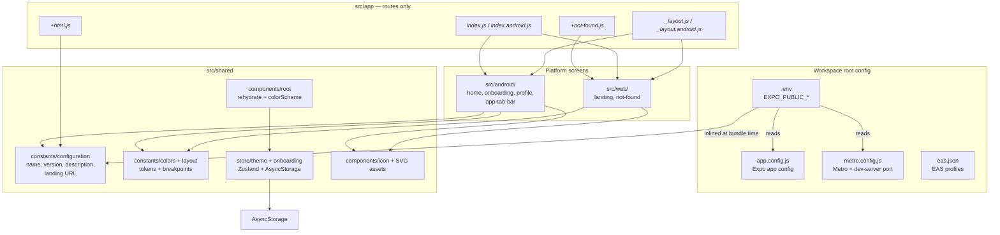
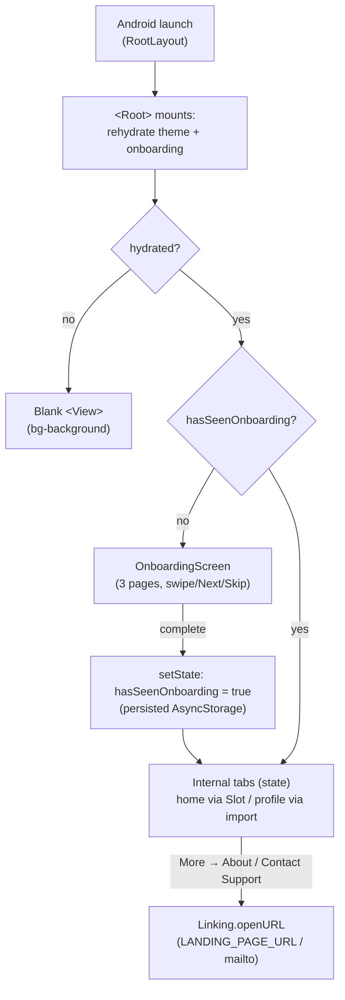
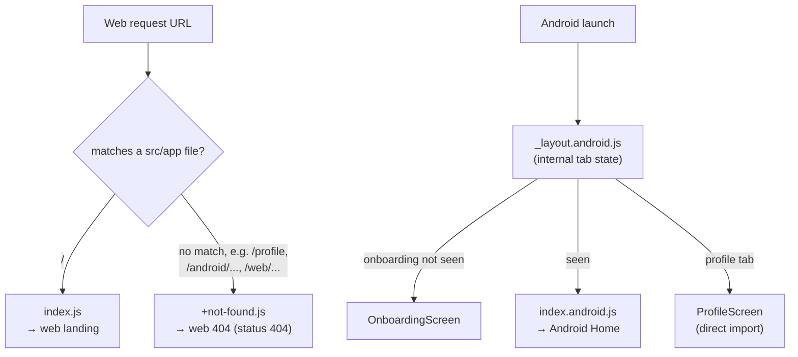
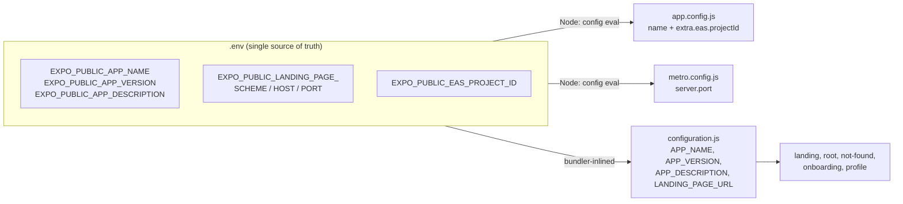

# Contributing

Thanks for contributing to **TipTap** — an endless scroll of AI-generated short titles and text paragraphs, built with Expo/React Native for Android and the web. This document covers the conventions and workflow to follow.

## Prerequisites

- **Node.js** (LTS) and **npm** — this repo uses npm (`package-lock.json`), not Bun or Yarn.
- **Expo CLI** via `npx` (no global install required).
- For Android builds: Android SDK / `adb`, or an **EAS** account for cloud builds.

## Setup

```bash
npm install
npx expo start        # then press w (web) or a (Android)
```

Use `npx expo install <package>` — never `npm install <package>` — when adding Expo or React Native dependencies so versions stay SDK-compatible.

## Project structure

See [README.md](README.md#project-structure) for the full file tree. Layers point in one direction: `src/app` routes → `src/web` / `src/android` screens → `src/shared`. Shared code must not import routes or platform screens.

### Architecture



### Startup, onboarding, and theming



### Routing and platform resolution



### Environment variables



## Conventions

### File naming

- All files and directories use **lower-case kebab-case**: `icon.js`, `home.svg`, `index.android.js`.
- Expo Router reserves a few route file names — use them as-is: `index`, `_layout`, `+html`, `+not-found`, `+middleware`.
- Platform suffixes stay lower-case and come last: `index.android.js`.
- JavaScript identifiers (components, exports) stay PascalCase — e.g. `export function Icon()` in `icon.js`. Only the **filename** is kebab-case.

### Routing (Expo Router)

- Routes live in `src/app/`. Expo Router auto-detects `src/app/` before a root `app/` — do not create a root `app/`.
- Split platform-specific routes with file extensions:
  - `*.android.js` — Android only
  - `*.js` — web and any platform without a specific route
- `_layout.js` (web) and `_layout.android.js` (Android) define the root layouts. Android uses a custom React Native tab bar driven by internal `home`/`profile` state (`index` via `Slot`, Profile via direct import) — tabs are not file-based routes.
- Shared routes keep a plain `.js` fallback: `index.js` + `index.android.js`, `_layout.js` + `_layout.android.js`. A platform-only file without a fallback sibling throws — never create a bare `*.android.js` route. The root holds only `index.js`, `index.android.js`, `_layout.js`, `_layout.android.js`, `+html.js`, and `+not-found.js`; unmatched web URLs such as `/profile` render `+not-found.js` with a 404 status.
- Route files at `src/app/` root are thin: they re-export a screen from `src/web` or `src/android`, or define a navigator/redirect.
- Import navigation APIs (`Link`, `router`, `useLocalSearchParams`, `Redirect`) from `expo-router`.

### Language & styling

- **Vanilla JavaScript only** — JSX in `.js` files. No TypeScript, no `.ts`/`.tsx`, no `tsconfig.json`.
- The package is **ESM** (`"type": "module"`): config files use `import`/`export default`, and CommonJS-only package subpaths are bridged with `createRequire(import.meta.url)`.
- Style React Native components with **Nativewind** `className` utilities; do **not** use inline `style` objects for presentation. Colors resolve through the semantic CSS variables in `src/shared/stylesheets/global.css` and the design tokens in `src/shared/constants/colors.js`. The only accepted computed props are non-style values such as an SVG `size` derived from layout tokens. See DESIGN.md for the color, typography, spacing, and responsive layout rules.
- The Android shell is **React Native** (no `@expo/ui`/Jetpack Compose). The bottom tab bar uses `Pressable` as the only touch target and marks icons/indicators `pointerEvents="none"` so taps are never intercepted. No XML/VectorDrawable icons — SVG only.
- Avoid UX animations/transitions unless explicitly requested. Use plain state/color/layout changes.
- Global state lives in **Zustand** stores under `src/shared/store/`. Persist with AsyncStorage (`skipHydration: true` + `rehydrate()` in `src/shared/components/root.js`) so static web rendering stays `window`-free.
- SVG icons in `src/shared/assets/icons/` are the source of truth. Render SVGs (including the brand logo `icon.svg`) with the shared cross-platform `src/shared/components/icon.js` wrapper: `<Icon as={Svg} size={24} accessibilityLabel="..." />` (pass `color` only for `fill="currentColor"` icons). `src/shared/assets/icons/icon.svg` remains the master for derived PNG assets.

### JSDoc

- **Every JavaScript module** starts with a JSDoc block containing an `@module` intro tag that names the module and summarizes its responsibility.
- Use the repo-relative path without the `.js` extension, e.g. `@module src/shared/constants/layout`.
- Keep the intro short and useful: what the module exports, when to use it, and any important constraint (SSR safety, platform-only behavior, etc.).
- **Never use `@example` tags** in JSDoc blocks. Inline code comments and documentation code blocks are fine; the JSDoc example tag is not.

Allowed:

```js
/**
 * Shared responsive layout tokens and breakpoint helpers.
 * @module src/shared/constants/layout
 */
```

Not allowed:

```js
/**
 * @module src/shared/constants/layout
 * @example
 * getLayoutClass(720);
 */
```

### Expo & native code

- Check the versioned Expo docs for SDK 57 (`https://docs.expo.dev/versions/v57.0.0/`) before using an Expo/EAS/RN API — APIs change between SDK releases.
- `ios/` and `android/` are generated (Continuous Native Generation). **Never create or edit them by hand** — configure native behavior in `app.config.js` and config plugins.
- Adding a library with native code requires a local development build (`npx expo run:android`); Expo Go will not include it.

## Verification

Run lint before declaring work done:

```bash
npx expo lint
```

> `expo lint` is not configured yet (no ESLint dependency). Set it up first if you need it; otherwise verify manually and keep the code consistent with existing style.

Until lint is configured, verify both bundles compile:

```bash
npx expo export --platform web       # static web build + route rendering
npx expo export --platform android   # Android JS bundle + SVG assets
```

## Commit & PR conventions

Commits use a **bracketed type prefix** followed by a short, imperative summary:

```
(feature) add web landing page and Android tab shell
(chore) configure ESLint
(fix) keep desktop layout after hydration
(refactor) extract shared logo component
(style) restyle the 404 page
```

| Prefix | Use for |
| --- | --- |
| `(feature)` | Newly added features |
| `(chore)` | Configuration, cleanups, upgrades, dependency bumps |
| `(fix)` | Bug fixes and hot fixes |
| `(refactor)` | Code refactors and optimizations |
| `(style)` | UI/UX changes |
| `(format)` | Code formatting, lint fixes, and whitespace-only changes |

- **Always commit.** After finishing any implementation (feature, fix, refactor, style, docs, or config change), commit the working tree immediately. Do not leave changes uncommitted.
- **One logical change per commit, but merge related commits.** Group the files that belong to the same logical change (even across directories) — e.g. keep a feature and its direct styling together, but don't mix an unrelated style pass, refactor, or docs rework into the same commit. If subsequent implementations turn out to be related, merge them into one focused commit rather than stacking tiny ones.
- Keep the subject line short and imperative; add a body when the change needs context.
- `(style)` means **UI/UX**; use `(format)` for code formatting such as Prettier or lint autofixes.
- Keep PRs focused and small; describe the change and how it was verified (platforms tested: web / Android).
- Reference related issues in the PR description.

## Don't

- Don't add TypeScript.
- Don't use PascalCase filenames or spaces in filenames — use lower-case kebab-case.
- Don't run `npm install <expo-or-rn-package>` directly (use `npx expo install`).
- Don't create a root `app/` directory.
- Don't hand-edit generated native directories.
- Don't commit secrets or `.env*.local` files.
